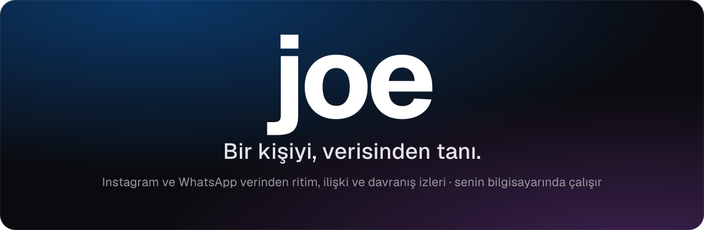
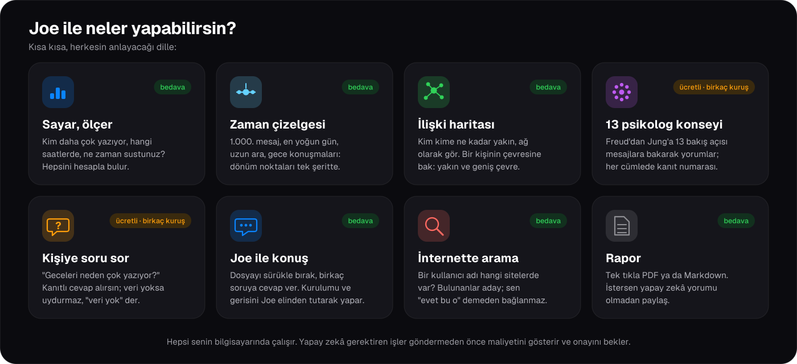
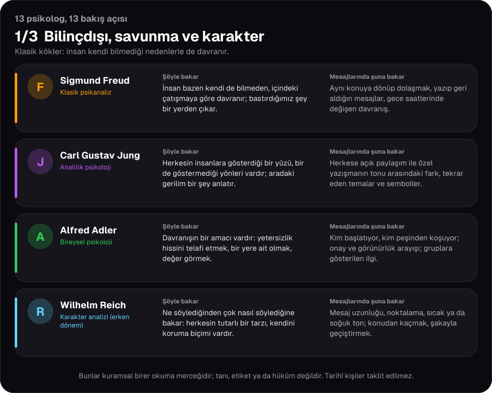
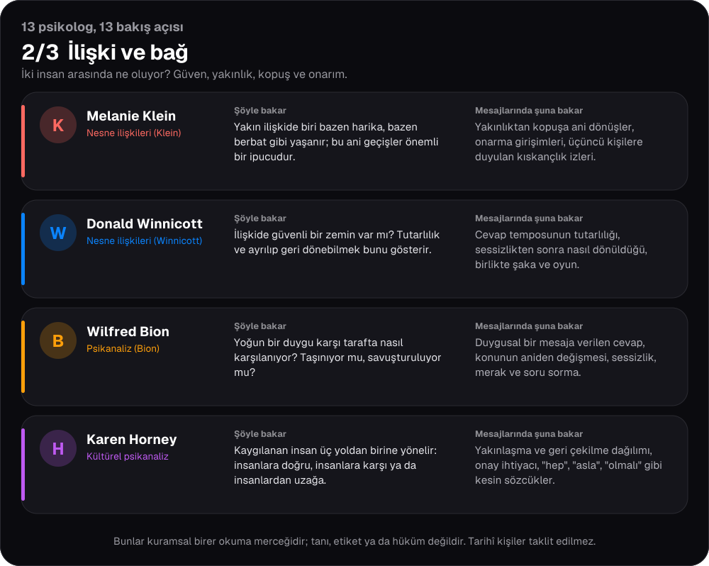
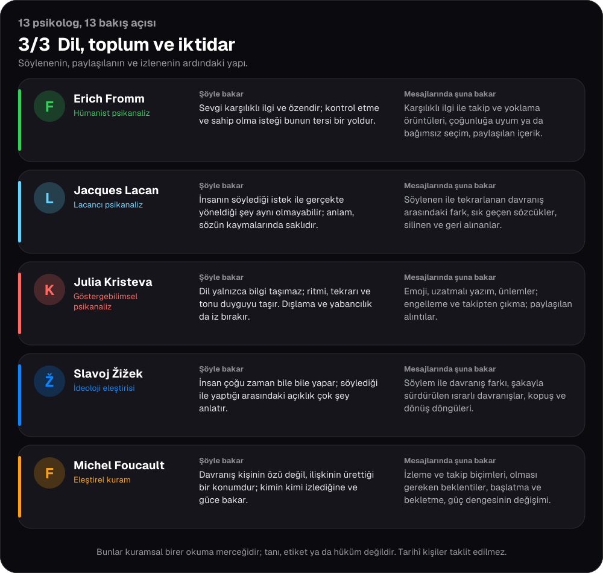

<p align="center">
  
</p>

<p align="center">
  <b>Instagram ve WhatsApp yazışmalarından bir insanı, ilişkiyi ve çevreyi anlamana yardım eden, tamamen bilgisayarında çalışan bir uygulama.</b>
</p>

<p align="center">
  <a href="#joe-nedir">Joe nedir?</a> ·
  <a href="#neler-yapıyor">Neler yapıyor?</a> ·
  <a href="#kurulum-3-adımda">Kurulum</a> ·
  <a href="#gizlilik-ve-güvenlik">Gizlilik</a> ·
  <a href="#teknik-ayrıntılar">Teknik ayrıntılar</a>
</p>

---

## Joe nedir?

Telefonunda yıllardır biriken sohbetler var. Kiminle ne kadar konuşuyorsun, hangi saatlerde yazışıyorsunuz,
bir arkadaşlık zamanla soğudu mu, kim daha çok adım atıyor? Cevabı o sohbetlerin içinde, ama 40 bin mesajı
tek tek okuyamazsın.

**Joe bunu senin yerine yapar.** WhatsApp sohbetini ya da Instagram verini ona verirsin; o da mesajları sayar,
ölçer, önemli anları bulur ve sana sade bir dille gösterir. İstersen bir adım daha atıp 13 farklı psikoloji
bakış açısından (Freud, Jung, Klein…) o kişiyi ve ilişkinizi yorumlatabilirsin. Hepsi senin bilgisayarında,
senin kontrolünde.

> **Kısaca:** Sohbetlerini ver, "bu insan kim, bu ilişki nasıl gidiyor?" sorusuna kanıtlı cevap al.

## Kimler için?

- Eski bir ilişkiyi ya da arkadaşlığı **kendi verinden** anlamak isteyenler
- "Bu kişiyle aramız zamanla nasıl değişti?" diye merak edenler
- Instagram'da kimlerle gerçekten yakın olduğunu görmek isteyenler
- Kendi dijital izini (hangi saatlerde yazıyorum, kime ne kadar zaman ayırıyorum) tanımak isteyenler

> ⚠️ Yalnızca **kendi verin** ya da **rızası olan birinin** verisiyle kullan. Joe tanı koymaz, kimseye puan vermez,
> kimsenin "tehlikeli" ya da "suçlu" olduğunu söylemez. Yorumlar birer **hipotezdir**, hüküm değil.

---

## Neler yapıyor?

<p align="center">
  
</p>

Ayrıntılı anlatım aşağıda:

### 📊 Önce sayar, ölçer (bedava)
Yapay zekâ olmadan, tamamen hesapla çalışır, **hiç para harcamaz**:
- Kim daha çok yazıyor, konuşmayı kim başlatıyor, kim daha geç cevap veriyor
- Hangi saatlerde, hangi günlerde yazışıyorsunuz; gece mesajlaşması ne kadar
- Uzun sessizlikler, en yoğun günler, ilişkinin gidişatındaki dönüm noktaları
- **Zaman çizelgesi:** sadece ilk ve son mesaj değil; 1.000. mesaj, en yoğun gün, uzun ara, gece konuşmaları, geri alınan mesajlar gibi önemli anlar
- Instagram'da: takipçi, takip, beğeni, yorum, hikâye etkileşimi, arama geçmişi

### 🕸️ İlişki haritası
Kimin kiminle ne kadar bağlı olduğunu bir ağ olarak görürsün. **Kişi bazlı harita** ile bir insanın çevresine
bakabilirsin: kimlerle karşılıklı takip ediyor, kimler yakın arkadaş, kimlerle çok yazışıyor. Çevre *yakın*
ve *geniş* diye ayrılır. İstemediğin birini haritadan gizleyebilirsin.

### 📇 Sohbet rehberi
Tüm bire-bir sohbetlerin tek listede: kimlerle, ne kadar, hangi saatlerde yazışıyorsun, konuşmayı kim başlatıyor, ne kadar
sessizlik oldu. Her sohbette **yakınlık** ve **çatışma** ifadelerinin geçtiği mesajlar sayılır (yalnızca sözcük sayımı; puan ya da
hüküm değil). Sohbetlere **ilişki etiketi** koyarsın (anne, baba, sevgili, yakın arkadaş, arkadaş…); Joe ipuçlarından öneri
çıkarır ama sen onaylamadan hiçbir etiket konmaz. Her sohbette "önemli anlar" listesi vardır (en yoğun gün, uzun sessizlik,
yoğun yazışma sonrası kopuş, ifadelerin yoğunlaştığı anlar, gece konuşmaları); birine basınca sohbet o ana açılır. **Meta bağlar**
sekmesi mesaj içeriğine hiç bakmadan hikâye izleme, beğeni, yorum ve arama gibi etkinliklerden kimlere ilgi gösterdiğini ve takip
dengeni çıkarır. Etiketler ve rehber, konsey analizinde bağlam olarak psikologlara da gider (bağlanma örüntüsü için).

### 🧠 13 psikolog konseyi
İstersen Freud, Jung, Klein, Winnicott gibi 13 farklı bakış açısı seçtiğin kişiyi **kanıtlara bakarak** yorumlar.
Sonra bir moderatör "kim neye katılıyor, kim nerede ayrışıyor" diye özetler, bir sentez de bunları birleştirir.
Her cümlenin yanında `K1`, `K2` gibi kanıt numaraları vardır; birine tıklarsan o mesajlar sağda açılır. Her yorumun
yanında "peki başka bir açıklama olabilir mi?" sorusu ve cevabı da bulunur.

<p align="center">
  
</p>

Mercekler birbiriyle konuşmaz: her biri yalnızca kanıt paketini görür, birbirinin çıktısını görmez. Karşılaştırmayı
moderatör, birleştirmeyi sentez yapar; her çıktı kanıtsız iddia, tanı dili ve kesinlik dili için denetlenir.

Kaliteyi artıran ek adımlar: gözlemler paketten **birebir alıntı** taşır ve kod alıntıyı gerçekten var mı diye doğrular;
sentezdeki her iddia için ayrı bir **kanıt doğrulaması** çalışır ("destekleniyor / kısmen / desteklenmiyor" rozeti);
moderatör, sentez ve doğrulama için ayrı bir **güçlü model** seçilebilir (Ayarlar); isteğe bağlı bir **amaç** cümlesi
okumayı odaklar; **Derin analiz** her dönemi ayrı özetleyip merceklere verir. İki kişilik analizde (örn. WhatsApp'ta
sen ve partnerin) iki taraf eşit okunur; WhatsApp içe aktarımında karşı taraf için kişi dosyası kendiliğinden açılır.
Kişi sayfasındaki **Geçmiş konseyleri gör** düğmesi önceki oturumları listeler.

### 13 psikolog kim, neye bakar?

Her mercek, o kuramın bakış açısını ödünç alır; **tarihî kişiyi taklit etmez**, ondan alıntı uydurmaz. Her biri için
"nasıl bakar" ve "mesajlarında neye bakar" kısaca anlatılıyor. Tamamı tanı değil, birer okuma merceğidir.

<p align="center"></p>
<p align="center"></p>
<p align="center"></p>

### 💬 Kişiye soru sor
Bir kişinin sayfasında "**Sor**" sekmesinden serbestçe soru sorabilirsin: *"Geceleri neden daha çok yazıyor?"*
Cevap yalnızca mesajlara ve ölçümlere dayanır; veri yoksa uydurmaz, "veri yetersiz" der. `@jung` yazarak tek bir
psikoloğa sorabilir, **tartışma modunda** birkaçına birden sorup aralarındaki farkı özetletebilirsin.

### 🤖 Joe ile konuş
Joe ile sohbet ederek de kullanabilirsin: *"Ayşe'yi analiz et"*, *"ben ve Ayşe uyumu"*, *"dosya ekle"*. İlk
kullanımda bir **kurulum sihirbazı** elinden tutar: dosyanı sürükle bırak, "bu verideki ben kim?" sorusunu cevapla,
kimi anlamak istediğini seç. Sağ alttaki mavi düğme her sayfada Joe'yu açar.

### 🔎 Açık kaynak araştırması (OSINT)
Bir kullanıcı adının internette hangi sitelerde olduğuna bakar (Sherlock, Maigret ve WhatsMyName listeleriyle),
GitHub/GitLab gibi açık dizinlerde isimle arar. Bulunanlar **aday**dır: aynı ada sahip başka biri olabilir.
Sen "evet bu o" demeden hiçbir şey kişinin dosyasına bağlanmaz.

### 📄 Rapor
Bir kişinin ya da konsey analizinin raporunu Markdown ya da PDF olarak indirebilirsin. Yapay zekâ yorumu olmadan
paylaşmak istersen "konseysiz" seçeneği vardır.

---

## Para harcar mı?

- **Sayma, ölçme, harita, zaman çizelgesi, arama: bedava.** Yapay zekâ kullanmaz.
- **Konsey ve soru-cevap için** bir yapay zekâ servisi (varsayılan: DeepSeek) kullanılır ve küçük bir ücret çıkar;
  bir analiz genelde **birkaç kuruş** tutar (örneğin 13 psikolog + sentez yaklaşık 10 sent civarı).
- Joe **göndermeden önce** tahmini maliyeti, modele gidecek tam metni ve hangi mesaj kesitlerinin seçildiğini
  gösterir. Sen onaylamadan hiçbir şey gönderilmez.
- Ayarlardan bir **bütçe tavanı** koyarsın; aşılmaz.

## Gizlilik ve güvenlik

- Verilerin **senin bilgisayarında** kalır. Uygulama yalnızca kendi bilgisayarından erişilebilir (`127.0.0.1`),
  internetten ulaşılamaz.
- Yapay zekâya giderken telefon numarası, e-posta, IP adresi, konum, IBAN, TC kimlik numarası gibi bilgiler
  **maskelenir**. Ham mesaj yığını asla olduğu gibi gönderilmez: önce ölçümler, sonra seçilmiş ve önizlediğin kanıtlar.
- API anahtarın şifreli saklanır, ekranda ve kayıtlarda görünmez.
- Joe'nun yazan işlemlerini (kişi aç, kimlik ekle, kaynak sil…) yapay zekâ kendi başına yapamaz; hep **senin
  onayını** bekler.
- Mesajında kendine zarar verme gibi bir ifade geçerse yapay zekâya gitmeden sorumlu bir yanıt verir.
- Joe **yapmaz:** klinik tanı koymak, birine "tehlikeli/suçlu" demek, kişi puanlamak.

---

## Kurulum (3 adımda)

Gerekenler: [Go](https://go.dev/dl/) 1.27+ (`GOTOOLCHAIN=auto` doğru sürümü kendisi indirir), Node.js ve pnpm.

```bash
git clone https://github.com/MustafaKemal0146/joe.git
cd joe
(cd web && pnpm install && pnpm build)   # arayüzü derle
go build -o joe ./cmd/joe
./joe                                    # tarayıcıda http://127.0.0.1:8777 açılır
```

Yapay zekâ özellikleri için **Ayarlar** sayfasından bir DeepSeek (ya da başka bir) anahtar eklemen yeterli;
anahtar olmadan da ölçümler, harita ve zaman çizelgesi çalışır.

### Verini nasıl alırım?

- **WhatsApp:** sohbeti aç → ⋮ menüsü → *Daha fazla* → **Sohbeti dışa aktar** (medyasız yeterli). Çıkan `.txt` dosyasını Joe'ya
  sürükle. Tarih biçimi (Android/iPhone, Türkçe/İngilizce) kendiliğinden anlaşılır.
- **Instagram:** *Hesap merkezi → Bilgilerini indir →* biçim olarak **JSON** seç. Gelen `.zip` dosyasını Joe'ya
  sürükle (çok büyükse dosya yolunu yazman daha hızlı olur).

Yüklemeden sonra Joe sana "bu verideki *ben* kim?" diye sorar; çünkü kimin hangi mesajı yazdığını bilmesi gerekir.

---

## Teknik ayrıntılar

Bu bölüm geliştiriciler ve merak edenler için. Kullanmak için okuman gerekmez.

<details>
<summary><b>Mimari ve durum</b></summary>

Tek bir Go ikilisi: **motor + HTTP sunucu + gömülü React arayüzü + komut satırı**. Veri yerel SQLite
veritabanında (WAL, FTS5) durur; sunucu yalnızca loopback'te dinler.

> Eski Python sürümü: [joe-python-eski](https://github.com/MustafaKemal0146/joe-python-eski)

| Aşama | İçerik | Durum |
|---|---|---|
| M1 | ZIP/dizin okuma, Instagram ve WhatsApp ayrıştırma, kişi dosyası, arayüz | ✅ |
| M2 | Metrikler, zaman çizelgesi, ilişki haritası, karşılaştırma | ✅ |
| M3 | Kanıt paketi, maskeleme, maliyet tahmini/onay, bütçe defteri, gömme dizini, anlamsal arama, konu kümeleme | ✅ |
| M4 | 13 persona + bütçeli konsey motoru (devam etme, onarım, denetim) + arayüz + iki kişilik mod + soru-cevap + değerlendirme düzeneği | ✅ |
| M5 | Go-native OSINT: güvenli sayfa çekme, kullanıcı adı taraması (WhatsMyName, Sherlock, Maigret), açık dizinler, doğrulama ve kişiye bağlama | ✅ |
| M6 | Sohbet: araç katmanı, onay kapıları, bütçe, notlar, niyet yönlendirmesi, kurulum sihirbazı, dosya bırakma, kişi dosyası soru-cevap, persona sohbeti ve tartışma modu | ✅ |

Açık işler [issue'larda](https://github.com/MustafaKemal0146/joe/issues) izlenir. WhatsApp ve Instagram (JSON) gerçek
dışa aktarımlarla denendi; Instagram'ın yeni ("label_values") biçimi de desteklenir. Instagram HTML biçimi henüz
desteklenmiyor (#3): dışa aktarırken **JSON** seç.

</details>

<details>
<summary><b>Komut satırı</b></summary>

```bash
./joe import instagram-verim.zip         # arayüz olmadan içe aktar
./joe import "WhatsApp Chat with X.txt"
./joe import instagram-1.zip instagram-2.zip   # çok parçalı arşiv
./joe export yedek.json                        # bütün veriyi dışa aktar (izin 0600)
./joe wipe                                     # bütün veriyi sil ("SİL" onayı ister)
./joe eval --yes --repeat 2                    # sentetik vakalarla kalite ölçümü (para harcar)
./joe version
./joe serve --no-browser --addr 127.0.0.1:8777
```

Veri klasörü: `$JOE_HOME` ya da kullanıcı ayar klasörü/`joe`. Saat dilimi: `$JOE_TZ` (varsayılan `Europe/Istanbul`).

</details>

<details>
<summary><b>Neler çıkarılır?</b></summary>

- **Instagram:** mesajlar (geri alınan, medya, paylaşım, arama), takipçi/takip/takipten çıkma/yakın arkadaş/engel, beğeni, yorum, kaydetme, hikâye etkileşimi, hesap ve kelime aramaları (tekrar sayısıyla), giriş etkinliği (cihaz, IP sayısı, saat).
- **WhatsApp:** mesajlar, medya, silinen/düzenlenen mesajlar, cevapsız aramalar, sistem satırları ayrı türlerde.
- **Zaman çizelgesi:** mesaj sayısı kilometre taşları, en yoğun günler, uzun sessizlikler, gece oturumları, tek taraflı seriler, geri alınan mesaj kümeleri ve ilk geçen anahtar ifadeler (yalnızca sözcük eşleşmesi; anlam yorumlanmaz).
- **Kişi özeti:** Kişiler sayfasındaki kartlar ve kişi sayfasındaki "Bir bakışta" bölümü yalnızca ölçülen değerlerden düz anlatım kurar.
- **Metrikler:** saat × gün ısı haritası, tahmini uyku penceresi, konuşmayı başlatma/bitirme, yanıt gecikmesi (medyan, %90), peş peşe mesaj, uzunluk asimetrisi, sessizlik süreleri, dil izleri (emoji, soru/ünlem, çeşitlilik), olağandışı yoğun/sessiz dönemler.
- **İlişki haritası:** mesaj, tepki, beğeni, yorum, hikâye, arama ve takip ilişkileri tek ağda; ad ile kullanıcı adı benzerliğinden birleştirme önerileri (onay senin). **Kişi bazlı** modda (ve kişi sayfasındaki **Çevre** sekmesinde) seçilen kişinin doğrudan bağlantıları, aralarındaki bağlar ve etkileşim türleri görünür: karşılıklı takip, yakın arkadaş, takip ediyor/takipçisi, mesajlaşıyor, beğeni, yorum, hikâye etkileşimi… Bağlantılar *yakın çevre* (yakın arkadaş, karşılıklı takip ya da karşı taraftan 50+ mesaj) ve *geniş çevre* olarak ayrılır; bu ayrım sezgiseldir, ilişki yargısı değildir. Takip ve yakın arkadaş bilgisi yalnızca kişinin kendi Instagram hesap verisi yüklüyse bulunur. Düğümler **haritadan gizlenebilir** (veri silinmez, "Gizlenenler"den geri gelir; hesap sahibi gizlenemez); bir kişi dosyası silinince düğümü haritada yalın hesap olarak yeniden belirmesin diye otomatik gizlenir. Genel bakışta kaynaklar ve kişi dosyaları kırmızı çarpıyla silinebilir (kaynak silme verisini kalıcı olarak siler, onay ister).
- **Karşılaştırma:** ben–o, o–başkası, herhangi iki kişi. Sonuç bir "uyum puanı" değil, boyut boyunca *benzerlik ve denge* göstergesidir; eksik veri açıkça listelenir.

</details>

<details>
<summary><b>Konsey nasıl çalışır?</b></summary>

`Konsey` sayfasından kişi (ya da iki kişi) seçilir, merceğler işaretlenir ve **önce maliyet aralığı, maskelenmiş
tam metin önizlemesi ve kanıt kesitleri gösterilir**. Onay verilmeden hiçbir şey sağlayıcıya gitmez; onay tek
kullanımlık, 15 dakika geçerli ve gösterilen içeriğe bağlıdır (içerik değişirse reddedilir).

- ≈ N+3 çağrı: N persona + 1 moderatör + 1 sentez + 1 kanıt doğrulaması (derin modda ek dönem özetleri). Ortak ön ek (sistem istemi + kanıt paketi) her çağrıda birebir aynıdır, bu yüzden sağlayıcının ön bellek indirimi işler.
- Her çıktı anında kaydedilir; yarıda kalan oturum **devam et** ile yalnızca eksik çağrıları yapar.
- Bütçe tavanı çağrı öncesi zorlanır; aynı paket+persona+model için yanıt önbellekten döner ve para harcanmaz.
- Çıktılar şemadan ve epistemik denetimden geçer; iddialar tıklanabilir `K1…` kanıtlara bağlıdır, her hipotezin karşı hipotezi vardır.
- **Dönem karşılaştırması:** en yoğun sohbet zamanın eşit üçte birine bölünür; mesaj yoğunluğu, kişinin payı, konuşma başlatma, gece payı ve sessizlik her dönem için kanıt paketine sayı olarak girer.
- **Sentez:** ayrıntılı özet, "zaman içinde gelişim" bölümü, uzlaşı/ayrışma, alternatif açıklamalar, açık sorular. Moderatör ayrışma bulduğu hâlde sentez bunu yansıtmazsa denetim uyarı ekler.
- **K kanıtları:** `K1`'e basınca ilgili mesajlar sağda bir çekmecede açılır (Esc ya da çarpı ile kapanır); "Sohbette bağlamıyla oku" tam sohbeti açar. Atıf kalabalığı için ilk iki kimlik görünür, geri kalanı açılır; üstteki düğmeyle hepsi gizlenebilir.
- **Rapor:** tamamlanmış oturumda "Markdown" düğmesi sentezi, persona görüşlerini ve kanıt kesit listesini indirir (ham mesaj metni eklenmez). Kişi sayfasının Markdown/PDF raporu, varsa kişinin son iki konsey oturumunu da "Konsey yorumları (yapay zekâ)" bölümü olarak ekler; yapay zekâ yorumu olmadan paylaşmak için "konseysiz" bağlantısını (`?konsey=0`) kullan.
- `joe eval`: sentetik vakalarla kalite ölçümü (para harcar, `--yes` ister; `--repeat N` şans etkisini azaltır, `--legacy-prompt` eski istemle A/B ölçümü yapar).
- Gömme dizini için Ayarlar'dan OpenAI uyumlu bir `/embeddings` adresi girilir. **"Ollama'yı otomatik bul"** yerel Ollama'daki gömme modellerini tarar, en uygununu (çok dilli, küçük) önerir, bir örnekle doğrular ve tek tıkla kurup dizinler. Yalnızca yerel (loopback) adreslerde çalışır; "yeni kaynakta otomatik dizinle" seçeneği de yalnızca yerel adreste çalışır, mesajlar uzak bir sunucuya kendiliğinden gitmez.

</details>

<details>
<summary><b>Soru sor ve Joe ile konuş</b></summary>

**Soru sor.** Kişi sayfasındaki **Sor** sekmesi, kişi dosyası hakkında serbest soru-cevaptır. Her soru gönderilmeden önce maliyetiyle gösterilir.

- Yanıt metriklere ve `K` kanıtlarına dayanır; veri yoksa "veri yetersiz" der. Paket, sorudaki sözcüklerle eşleşen mesajları (tam metin; gömme yereldeyse anlam araması da) çevreleriyle ekler.
- `@jung` gibi başlarsan soru tek bir kuramsal merceğe gider.
- **Tartışma modu:** aynı soruyu 2–4 merceğe sorar; "Ayrışmaları özetlet" ayrı bir onaylı çağrıyla uzlaşı ve ayrışmayı çıkarır. Bir yanıta **itiraz** edersen yalnızca o mercek yeniden çalışır.
- "Önceki soruya devam" önceki soru ve cevabın kısa özetini ekler (kanıt sayılmaz).

**Joe ile konuş.** Sol menüdeki sayfa (ve her sayfanın sağ altındaki küçük panel), uygulamayı yöneten bir sohbettir. Güvenlik kuralları yapısaldır:

- Kısa komutlar (`kişiler`, `kaynaklar`, `harcama`, `harita`…) ve yaygın niyetler ("Ayşe'yi analiz et", "ben ve Ayşe uyumu", "dosya ekle") LLM'siz ve ücretsiz çalışır; bütçe dolsa da çalışır. Birden çok kişi eşleşirse sorar, tahmin etmez.
- **Kurulum sihirbazı:** veri yokken kendiliğinden açılır, sonradan yeniden açılabilir. WhatsApp `.txt` ve Instagram `.zip` dosyalarını sohbete sürükleyip bırakabilir (ya da yol yazabilirsin); platform, sohbet/mesaj sayısı, tarih aralığı ve uyarıları gösterir, yinelenen dosyayı fark eder, hesap sahibini ve kimi analiz edeceğini sorar. Aynı kişi olabilecek bir ad çıkarsa sorar, kendiliğinden birleştirmez. Rıza cevabı kişi dosyasına not olarak yazılır; "ikisi de değil" denirse analiz başlamaz.
- Model yalnızca **özet metrik** görür (ham mesaj metni asla). Yazan işlemleri (kişi aç, kimlik ekle, sahip belirle, not al, kaynak sil) model **çalıştıramaz**; yalnızca onay kartı üretir. Yürütme senin ayrı onayınla ve tek seferliktir; geri alınamaz işlemler kırmızı onay ister.
- Mesajındaki risk ifadesi (kendine zarar vb.) modele gitmeden sorumlu bir yanıtla karşılanır (112 yönlendirmesi).
- Sohbet başına bütçe tavanı (varsayılan $0,10) çağrıdan önce zorlanır; analiz sohbette yapılmaz, Konsey sayfası hazırlanır ve maliyet onayı orada alınır.

</details>

<details>
<summary><b>OSINT</b></summary>

`OSINT` sayfasında üç yol vardır: (1) kullanıcı adını herkese açık sitelerde arama: **WhatsMyName, Sherlock ve Maigret** listelerinden biri seçilir (listeler senin isteğinle indirilir, depoya gömülmez; yalnızca GET ile denetlenebilen siteler kullanılır, desteklenmeyenler atlanır ve sayılır; Maigret'te popülerliğe göre en çok N site taranır, varsayılan 1500); (2) **açık dizinler:** GitHub, GitLab, Codeberg ve (tam ad için) Stack Overflow'un herkese açık arama uçlarında kullanıcı adı ya da tam ad araması; (3) **elle araştırma planı:** Google/Bing/DuckDuckGo arama bağlantıları (Joe bu adreslere istek atmaz, yalnızca sen tıklayınca açılır). Bulgular tarama sürerken listeye düşer. Sonuçlar **aday bulgudur**; hata veren siteler "hesap yok" sayılmaz, ayrı listelenir. Bir bulgu ancak sen **doğrularsan** kişi dosyasına bağlanabilir ve konseye ancak sen isteyince eklenir.

</details>

<details>
<summary><b>Yapı taşları</b></summary>

- `internal/evidence`: metriklerin tetiklediği, `K1…` kimlikli, token bütçesine sığan, deterministik kanıt paketi (`GET /api/people/{id}/evidence`)
- `internal/mask`: telefon, e-posta, IP, konum, IBAN, TCKN, profil bağlantısı maskeleme
- `internal/budget` + defter: maliyet tahmini (aralık), bütçe tavanı, tek kullanımlık onay, yanıt önbelleği
- `internal/personas`: 13 mercek, ortak sözleşme, çıktı şeması doğrulaması; `$JOE_HOME/personas` ile özelleştirilebilir
- `internal/audit` ve `internal/safety`: kanıtsız iddia / teşhis dili denetimi ve risk ifadesi tespiti
- `internal/osint/safefetch`: bağlantı anında IP doğrulayan SSRF korumalı sayfa çekme
- Yeni bir platform eklemek: `internal/ingest/<platform>` adaptörü + `model.Import` çıktısı; analiz katmanı platformu bilmez.

</details>

<details>
<summary><b>Güvenlik ayrıntıları</b></summary>

- Yalnızca loopback; `Host`/`Origin` denetimi DNS yeniden bağlama ve çapraz site isteklerini reddeder.
- ZIP açılmaz, `fs.FS` olarak okunur; yol geçişi, zip bombası (boyut/oran/girdi sayısı), şifreli girdi ve sembolik bağlantılara karşı sınırlar vardır.
- API anahtarları AES-256-GCM ile şifreli saklanır, arayüze geri gönderilmez.
- Klinik tanı, tehlikelilik, suçluluk ya da kişi puanlama üretilmez. Çıktılar kanıta bağlı yorumdur.

</details>

<details>
<summary><b>Geliştirme</b></summary>

```bash
go vet ./... && go test ./...
(cd web && pnpm test && pnpm build)
(cd web && pnpm dev)   # joe serve --no-browser ile birlikte; /api istekleri 8777'ye yönlenir
```

Kurallar [AGENTS.md](AGENTS.md) dosyasındadır.

</details>

---

<p align="center">
  <sub>Verinle, senin bilgisayarında, senin iznin kadar. · Yorumlar hipotezdir, hüküm değildir.</sub>
</p>
